<div align="center">
  <a href="https://github.com/AtaCanYmc/robo-market-search">
    
  </a>

  <h1>Robo Market Search</h1>

  <p>
    <b>Türkiye'nin 6 Büyük Robotik ve Elektronik Pazarı İçin Akıllı Arama &amp; Sepet Optimizasyonu</b>
  </p>

  [](https://pypi.org/project/robo-market-search/)
  [](https://pypi.org/project/robo-market-search/)
  [](https://github.com/AtaCanYmc/homebrew-tap)
  [](https://www.python.org/downloads/)
  [](https://opensource.org/licenses/Apache-2.0)
  [](https://github.com/AtaCanYmc/robo-market-search/actions/workflows/test.yml)
  [](https://github.com/AtaCanYmc/robo-market-search/actions/workflows/release-please.yml)
  [](https://github.com/AtaCanYmc/robo-market-search/stargazers)
  [](https://github.com/AtaCanYmc/robo-market-search/commits/main)
  [](CODE_OF_CONDUCT.md)
</div>

<br/>
Türkiye'nin en popüler 6 elektronik ve robotik pazarında (**Robolink, Robotistan, Robo90, Direnç.net, Özdisan, Motorobit**) tek satır kodla, çok hızlı ve eşzamanlı arama yapmanızı sağlayan Python kütüphanesi ve ekosistemi.

Ayrıca yerleşik **REST API**, **CLI (Komut Satırı)**, **MCP (Model Context Protocol)** sunucusu, **Yapay Zeka Donanım Ajanı (BYOK destekli)** ve **Vite + React Web Önyüzü** içerir.

## Özellikler
- **Unified Search (Birleştirilmiş Arama)**: 6 markette paralel (`ThreadPoolExecutor`) olarak eşzamanlı arama yapar ve ürünleri ucuzdan pahalıya sıralar.
- **Sepet Optimizasyonu ve Kargo Hesaplama (`cart_search`)**: Birden fazla parça alırken kargo limitlerini (ücretsiz kargo eşiklerini) ve mağazalar arası bölünmüş sepet (split cart) maliyetlerini otomatik optimize eder.
- **BYOK Destekli Yapay Zeka Ajanı (AI Hardware Agent)**: Kendi API anahtarınızla (OpenAI, Gemini, Anthropic, DeepSeek, Groq, Ollama) donanım analizi ve BOM listesi çıkarır.
- **Masaüstü ve Web Önyüzü (Tauri + Vite + React)**: Canlı arama, filtreleme, stok takibi, sepet optimizasyonu ve **CSV / JSON / Markdown / Clipboard** dışa aktarma.
- **Skill ve Chrome Eklentisi**: [`bom-sourcing`](https://github.com/AtaCanYmc/bom-sourcing) ajan skill'i repolardan BOM çıkarır ve canlı fiyatı bu projeyle karşılaştırır. [bomTR](https://chromewebstore.google.com/detail/bomtr/mllknkaempcjocdjibelcjohjadnffep) Chrome eklentisi BOM listesini yan panelde yönetir ([`bom-tr`](https://github.com/AtaCanYmc/bom-tr)). Ayrıntı: [docs/integrations.md](docs/integrations.md).
- **Dayanıklılık ve Önbellek**: Arızalı marketler devre kesici (circuit breaker) ile geçici olarak atlanır, bot koruması sonrası `User-Agent` değiştirilerek yeniden denenir. Sonuçlar SQLite veya isteğe bağlı Redis önbelleğinde market bazlı TTL ile tutulur.
- **Dinamik Token Mimarisi**: API anahtarı veya oturum token'ı değişikliklerinde otomatik yenilenir.
- **CLI (`robo-search`)**: Terminal üzerinden tablolar ve canlı ilerleme çıktısıyla hızlı ürün araması.
- **LLM/MCP Entegrasyonu (`robo-mcp`)**: Claude Desktop, Antigravity ve VS Code (Cline / RooCode) asistanlarına canlı mağaza fiyat sorgulama yeteneği.

## Tanıtım Videosu

<div align="center">
  <a href="https://youtu.be/zGbcepQuVU0">
    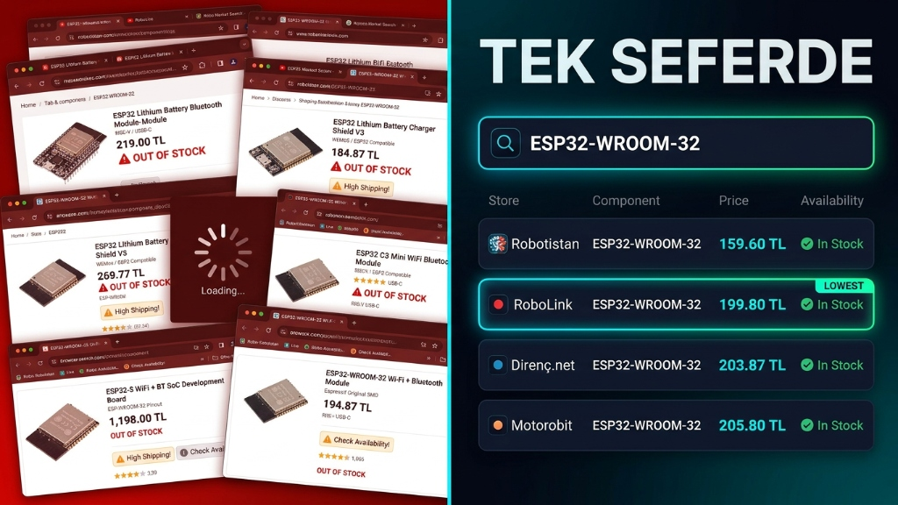
  </a>
  &nbsp;
  <a href="https://youtu.be/zGbcepQuVU0">
    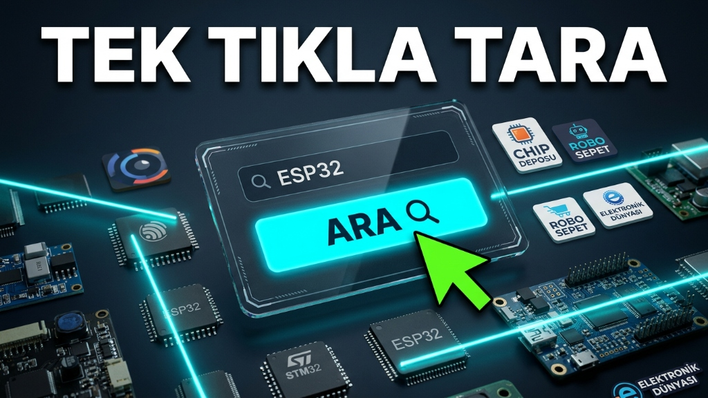
  </a>
  <p><a href="https://youtu.be/zGbcepQuVU0">YouTube'da İzle (20 sn): 6 Mağazada Paralel Arama, Split-Cart Optimizasyonu ve BYOK Donanım Ajanı</a></p>
</div>

## İçindekiler

- [Dokümantasyon](#dokümantasyon)
- [4 Katmanlı Mimari](#4-katmanlı-mimari-4-layered-architecture)
- [Ekosistem Mimarisi](#ekosistem-mimarisi)
- [Kurulum](#kurulum)
- [Komut Satırı Arayüzü (CLI) Kullanımı](#komut-satırı-arayüzü-cli-kullanımı)
- [REST API Sunucusu (`robo_market_api`)](#rest-api-sunucusu-robo_market_api)
- [Telegram Bot Entegrasyonu](#telegram-bot-entegrasyonu)
- [Model Context Protocol (MCP) Sunucusu](#model-context-protocol-mcp-sunucusu)
- [Hızlı Başlangıç (Python SDK)](#hızlı-başlangıç-python-sdk--birleştirilmiş-arama)
- [Sepet Optimizasyonu ve Kargo Hesaplama (`cart_search`)](#sepet-optimizasyonu-ve-kargo-hesaplama-cart_search)
- [Sıkça Sorulan Sorular](#sıkça-sorulan-sorular-sss--faq)
- [Katkıda Bulunma](#katkıda-bulunma)

---

## Dokümantasyon

Projenin tüm teknik belgeleri `docs/` dizininde yer alır:

| Doküman | Açıklama | Bağlantı |
| :--- | :--- | :--- |
| **Getting Started** | Hızlı başlangıç ve ekosistem özeti | [docs/getting-started.md](docs/getting-started.md) |
| **Mimari (Architecture)** | 4 katmanlı mimari, ThreadPool ve akış şemaları | [docs/architecture.md](docs/architecture.md) |
| **Kurulum (Installation)** | `pipx`, `brew`, `curl`, `pip`, `docker` kurulum matrisi | [docs/installation.md](docs/installation.md) |
| **Konfigürasyon** | Ortam değişkenleri, kargo limitleri ve BYOK anahtar yönetimi | [docs/configuration.md](docs/configuration.md) |
| **Python SDK** | `Client`, `UnifiedSearchClient`, `RoboMarketAgent` API referansı | [docs/sdk.md](docs/sdk.md) |
| **CLI Referansı** | `robo-search` ve `robo-agent` terminal rehberi | [docs/cli.md](docs/cli.md) |
| **MCP Sunucusu** | Claude Desktop, Cursor ve VS Code MCP entegrasyonu | [docs/mcp.md](docs/mcp.md) |
| **Telegram Bot** | `robo-bot` kurulumu, BotFather ve webhook rehberi | [docs/telegram.md](docs/telegram.md) |
| **REST API** | FastAPI OpenAPI uç noktaları, BYOK HTTP başlıkları | [docs/api.md](docs/api.md) |
| **Store Plugin Geliştirme** | `BaseStore` ve `@register_store` ile yeni market eklentisi yazma | [docs/plugin-development.md](docs/plugin-development.md) |
| **Provider Rehberi** | Yerleşik mağaza kazıyıcıları ve mimarisi | [docs/providers.md](docs/providers.md) |
| **Geliştirici Rehberi** | Katkı sağlama, `pytest`, `ruff` ve CI/CD süreçleri | [docs/development.md](docs/development.md) |
| **Sorun Giderme** | Sık karşılaşılan hatalar ve çözümleri | [docs/troubleshooting.md](docs/troubleshooting.md) |
| **SSS (FAQ)** | Sıkça sorulan sorular | [docs/faq.md](docs/faq.md) |
| **Entegrasyonlar** | `bom-sourcing` skill'i ve bomTR Chrome eklentisi | [docs/integrations.md](docs/integrations.md) |
| **Bulut Barındırma** | `robo-api` için ücretsiz bulut seçenekleri (Oracle, HF Spaces, Cloud Run) | [docs/hosting.md](docs/hosting.md) |
| **Bruno API Koleksiyonu** | Uç nokta istekleri ve doğrulamaları, `make test-api` ile çalışır | [bruno/README.md](bruno/README.md) |
| **Yol Haritası** | Gelecek sürümler ve hedeflenen özellikler | [docs/roadmap.md](docs/roadmap.md) |
| **Mimari Kararlar (ADR)** | Mimari karar kayıtları (`ThreadPool`, `4-Layer`) | [docs/adr/](docs/adr/) |

---

## 4 Katmanlı Mimari (4-Layered Architecture)

Proje tam bağımsız mantıksal katmanlardan oluşur:


1. **`robo_market_api`**: Üretim ortamına hazır HTTP REST API katmanı. FastAPI, Pydantic v2, Swagger UI (`/docs`), ReDoc (`/redoc`) ve Bring Your Own API Key (BYOK) desteği sunar.
2. **`robo_market_agent`**: Yapay Zeka Ajanı. Pydantic modelleri ve takılabilir LLM Sağlayıcıları (OpenAI, Gemini, Anthropic, DeepSeek, Groq, Ollama, Mock) üzerinden 7 adımlı boru hattı çalıştırır.
3. **`robo_market_service`**: Arama servis katmanı. Önbellek, eşanlamlı terim açılımı (synonyms) ve sıralama mantığı sunar.
4. **`robo_market_search`**: Temel arama kütüphanesi. Sıfır HTTP/FastAPI/AI bağımlılığına sahip saf Python SDK.

---

## Ekosistem Mimarisi


---

## Kurulum

### Hızlı Başlangıç (Docker)

```bash
git clone https://github.com/AtaCanYmc/robo-market-search.git
cd robo-market-search
docker compose up -d
```

REST API `http://localhost:8000/docs` adresinde ayağa kalkar.

### 1. `pipx` (CLI ve Ekosistem İçin Önerilen)

Global Python ortamını etkilemeden CLI, MCP ve AI ajan araçlarını izole sanal ortama kurar:

```bash
pipx install "robo-market-search[all]"
```

Doğrudan GitHub üzerinden kurulum:

```bash
pipx install "robo-market-search[all] @ git+https://github.com/AtaCanYmc/robo-market-search.git"
```

### 2. Homebrew Tap (macOS ve Linux)

```bash
brew install atacanymc/tap/robo-market-search
```

Kurulum sonrasında `robo-search "ESP32"` komutuyla doğrudan arama yapılabilir.

### 3. Tek Satır Kurulum Scripti (cURL / Shell)

```bash
curl -fsSL https://raw.githubusercontent.com/AtaCanYmc/robo-market-search/main/install.sh | bash
```

### 4. Bağımsız Masaüstü ve Binary Paketler

Python kurulu olmayan sistemler için [GitHub Releases](https://github.com/AtaCanYmc/robo-market-search/releases) sayfasından macOS, Windows veya Linux kurulum paketini indirin.

### 5. Python SDK ve Geliştirici Kurulumu (`pip`)

```bash
# Sadece Core SDK (kazıyıcılar ve birleştirilmiş arama)
pip install robo-market-search

# Tüm ekosistem (REST API + CLI + MCP + AI Agent)
pip install "robo-market-search[all]"
```

### Masaüstü ve Web Arayüz Özellikleri

- **Eşzamanlı Ürün Araması**: 6 markette paralel arama, canlı stok ve renkli mağaza rozetleri.
- **Toplu Arama (Batch Search)**: Birden fazla bileşeni tek ekranda arama ve gruplama.
- **Sepet Optimizasyonu**: Mağazalar arası ücretsiz kargo barajlarını ve bölünmüş sepet maliyetlerini analiz etme.
- **BYOK Yapay Zeka Ajanı**: Kendi OpenAI, Gemini, Anthropic, DeepSeek, Groq veya Ollama anahtarınızla donanım analizi ve BOM oluşturma.
- **Dışa Aktarma (Export)**: Arama sonuçlarını **CSV**, **JSON**, **Markdown** formatlarında indirme veya panoya kopyalama.

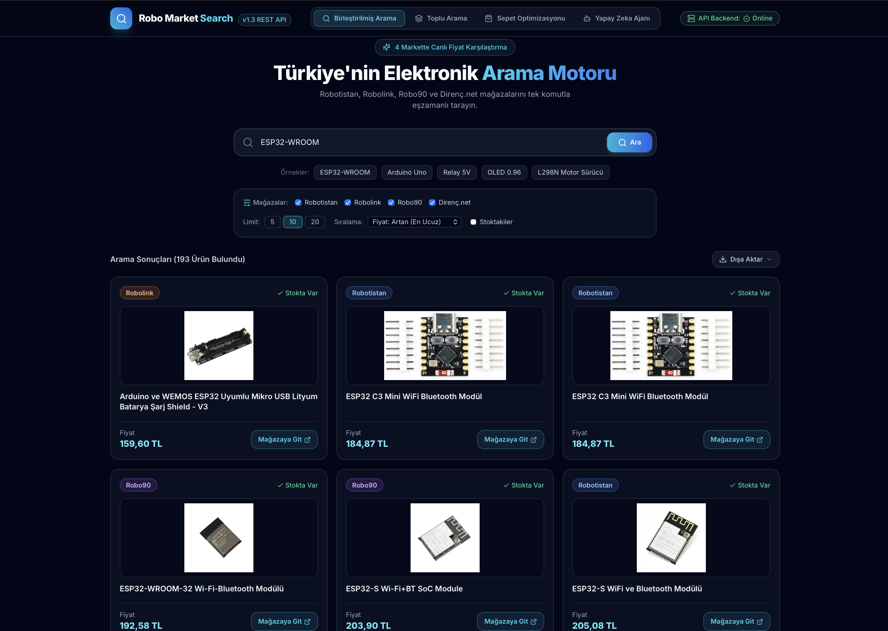

### Yapay Zeka Donanım Ajanı Görsel Arayüzü (BYOK)

<div align="center">
  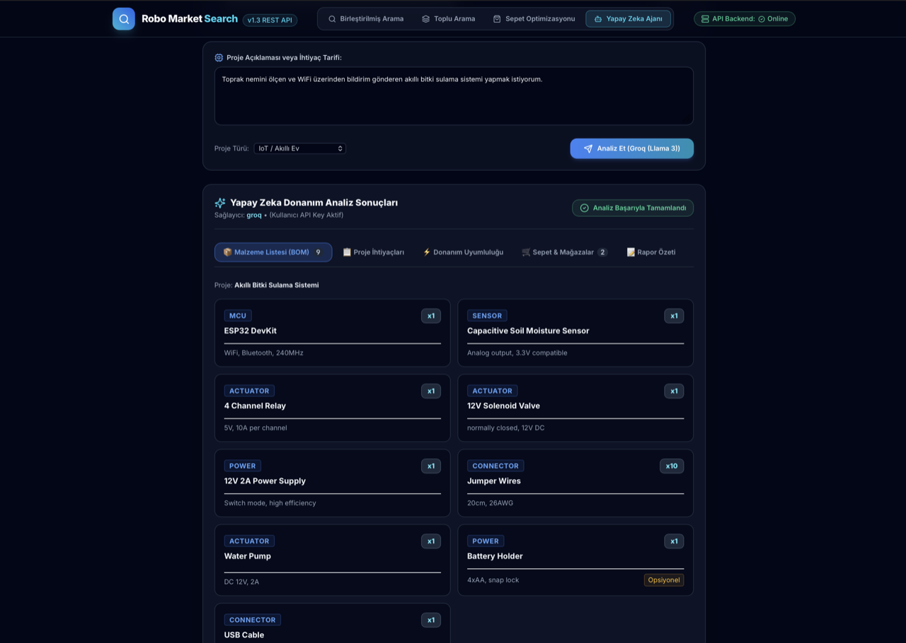
  &nbsp;
  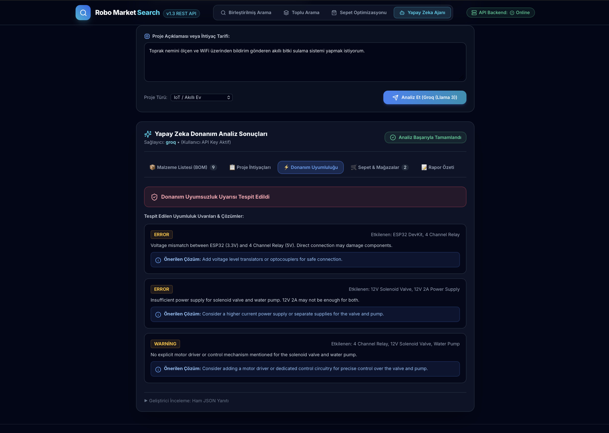
  <br/><br/>
  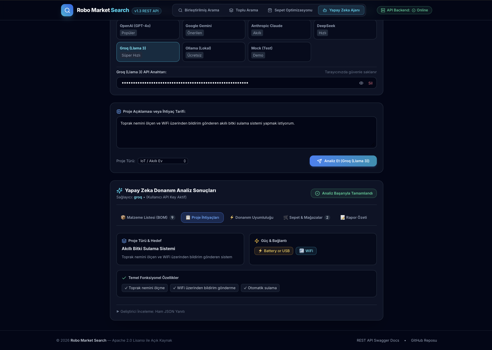
  &nbsp;
  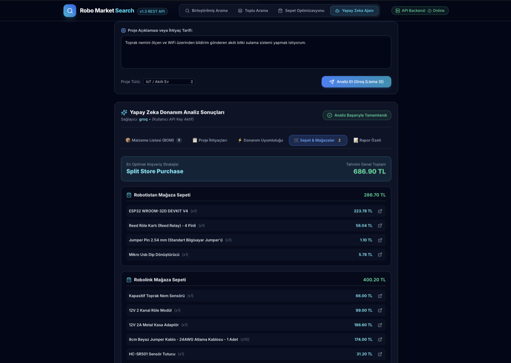
</div>

---

## Komut Satırı Arayüzü (CLI) Kullanımı

Uygulamayı `[cli]` veya `[all]` etiketiyle kurduktan sonra terminalden anında arama yapabilirsiniz:

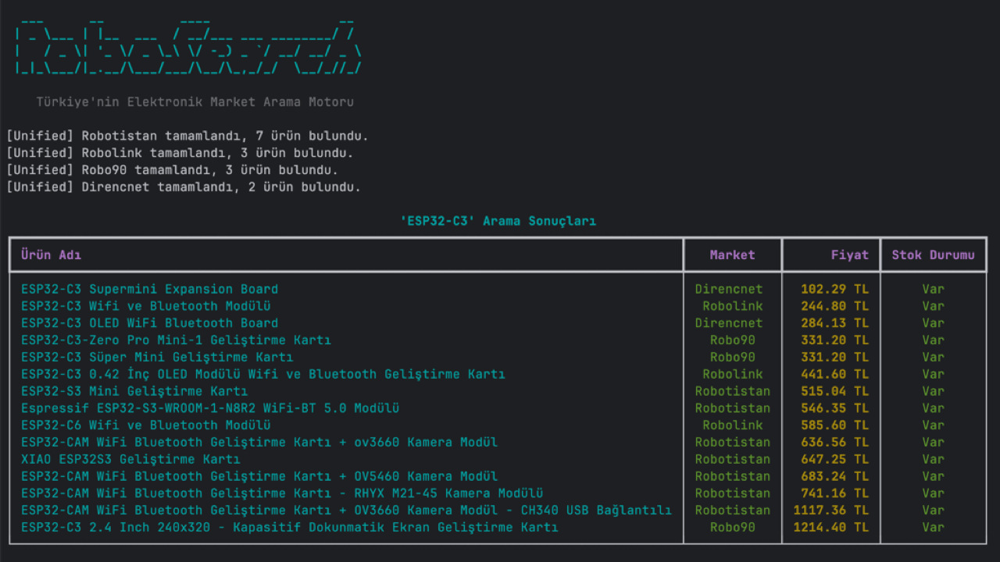

```bash
# Temel arama (Tüm marketleri tarar, en ucuzdan pahalıya sıralar)
robo-search "ESP32-WROOM"

# Limit belirterek arama
robo-search "Arduino Uno" --limit 3

# Fiyat sıralamasını devreden çıkarma
robo-search "PLA Filament" --no-sort
```

---

## REST API Sunucusu (`robo_market_api`)

Production-ready FastAPI REST API katmanı ile `robo-market-search` özelliklerini HTTP servisleri olarak sunabilirsiniz.

### Çalıştırma

```bash
# REST API başlatma
robo-api
```
veya doğrudan Uvicorn ile:
```bash
uvicorn robo_market_api.app.main:app --host 0.0.0.0 --port 8000 --reload
```

### API Dokümantasyonu (Swagger ve ReDoc)

- **Swagger UI**: [http://localhost:8000/docs](http://localhost:8000/docs)
- **ReDoc**: [http://localhost:8000/redoc](http://localhost:8000/redoc)
- **OpenAPI JSON**: [http://localhost:8000/openapi.json](http://localhost:8000/openapi.json)

### Örnek Endpoint İletişimleri

#### Sağlık Kontrolü (`GET /health` veya `GET /api/v1/health`)
```bash
curl -X GET http://localhost:8000/api/v1/health
```
**Yanıt:**
```json
{
  "status": "ok",
  "version": "1.11.1"
}
```

#### Ürün Arama (`POST /api/v1/search`)
```bash
curl -X POST http://localhost:8000/api/v1/search \
  -H "Content-Type: application/json" \
  -d '{"query": "ESP32", "limit": 3}'
```
**Yanıt:**
```json
{
  "success": true,
  "query": "ESP32",
  "count": 3,
  "products": [
    {
      "title": "ESP32-WROOM-32 Wi-Fi + Bluetooth Modülü",
      "price": 145.50,
      "formatted_price": "145,50 TL",
      "url": "https://www.robotistan.com/esp32",
      "store": "robotistan",
      "in_stock": true
    }
  ]
}
```

#### Toplu Arama (`POST /api/v1/search/batch`)
```bash
curl -X POST http://localhost:8000/api/v1/search/batch \
  -H "Content-Type: application/json" \
  -d '{"queries": ["ESP32", "Relay 5V", "OLED 0.96"]}'
```

#### Mağaza Sağlayıcıları (`GET /api/v1/providers`)
```bash
curl -X GET http://localhost:8000/api/v1/providers
```

#### Belirli Bir Mağazada Arama (`POST /api/v1/providers/{provider}`)
```bash
curl -X POST http://localhost:8000/api/v1/providers/robotistan \
  -H "Content-Type: application/json" \
  -d '{"query": "Arduino Uno"}'
```

---

## Telegram Bot Entegrasyonu

Projenizi kişisel bir elektronik arama asistanına dönüştürmek için yerleşik bir Telegram botu da barındırır. `aiogram` kullanılarak geliştirilen bu asenkron bot, saniyeler içinde marketleri tarar ve en ucuz ürünleri size linkleriyle birlikte mesaj olarak atar.

<p align="center">
  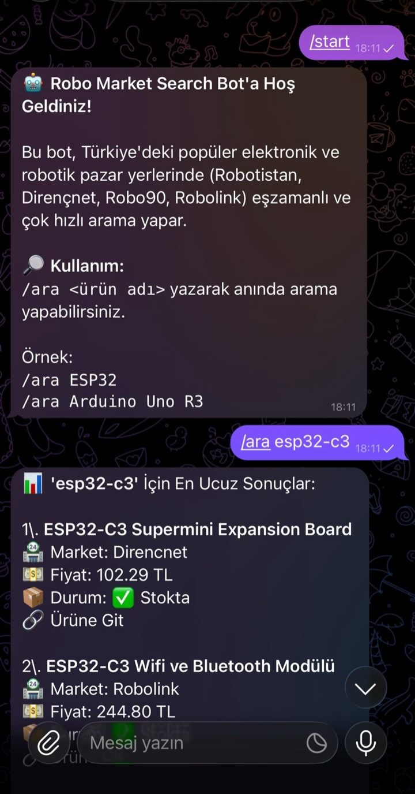
  &nbsp;&nbsp;&nbsp;
  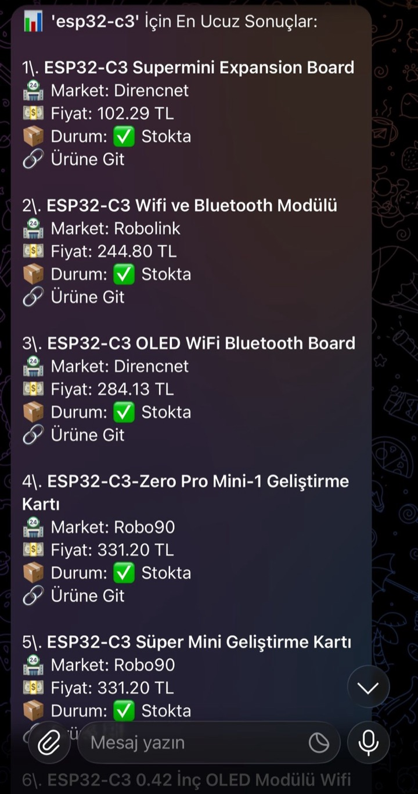
</p>

### Kullanımı

1. Telegram üzerinden `@BotFather` ile yeni bir bot oluşturun ve token'ınızı alın.
2. Botu başlatmak için terminalden komutu token ile birlikte çalıştırın:

```bash
robo-bot --token "SİZİN_TELEGRAM_TOKENINIZ"
```

*(Alternatif olarak `TELEGRAM_BOT_TOKEN` isimli bir ortam değişkeni (environment variable) tanımlayarak sadece `robo-bot` yazarak da çalıştırabilirsiniz.)*

Bot çalıştıktan sonra Telegram uygulamasından botunuza `/ara ESP32` veya `/ara Arduino Uno` yazarak doğrudan arama yapabilirsiniz.

---

## Model Context Protocol (MCP) Sunucusu

Proje, LLM'ler (örn. Claude Desktop) için resmi MCP (Model Context Protocol) sunucusu içerir. Bu sayede yapay zeka asistanınız projeleriniz için doğrudan Türkiye pazarındaki elektronik parçaların fiyat ve stok durumunu **canlı olarak** sorgulayabilir.

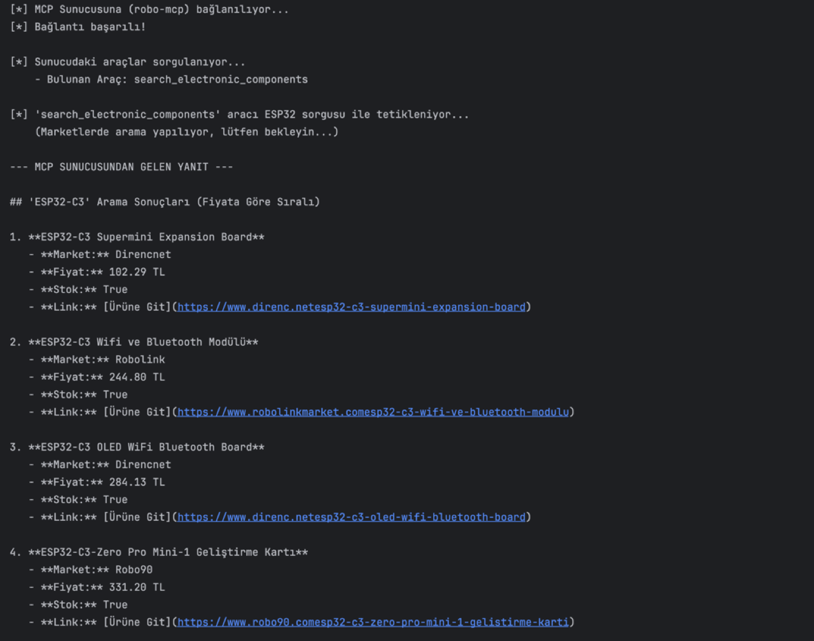

### Sunucuyu Başlatma ve Test Etme

MCP sunucusunun sağlıklı çalışıp çalışmadığını Claude'a bağlamadan önce test etmek isterseniz, paketle birlikte gelen örnek test script'ini çalıştırabilir veya resmi MCP Inspector aracını kullanabilirsiniz.

**1. Python İstemcisi ile Test:**
Kendi yazdığımız bir Python scripti ile sunucuyu sanki bir LLM'miş gibi tetikleyebilirsiniz:
```bash
python examples/mcp_client_example.py
```

**2. Resmi MCP Inspector ile Test (Görsel Arayüz):**
Web tarayıcınız üzerinden görsel olarak test etmek için npx ile inspector'ı başlatın:
```bash
npx @modelcontextprotocol/inspector robo-mcp
```
*(Bu komut lokalinizde bir web sunucusu başlatır ve tarayıcı üzerinden aracı test etmenize olanak tanır.)*

### LLM İstemcilerine (Clients) Kurulum

Yapay zeka asistanlarının bu aracı kullanabilmesi için ayar dosyalarına aşağıdaki JSON konfigürasyonunu eklemeniz yeterlidir:

```json
{
  "mcpServers": {
    "robo-market-search": {
      "command": "robo-mcp",
      "args": []
    }
  }
}
```

**Not:** Komutun çalışabilmesi için `robo-mcp` komutunun sistem PATH'inize eklenmiş olması gerekir. Gerekirse `"command": "/tam/yol/.venv/bin/robo-mcp"` şeklinde absolute (tam) dosya yolunu da verebilirsiniz.

Bu konfigürasyonu kullandığınız asistana göre aşağıdaki konumlara ekleyebilirsiniz:

#### 1. Claude Desktop
Windows için `%APPDATA%\Claude\claude_desktop_config.json`, macOS için `~/Library/Application Support/Claude/claude_desktop_config.json` dosyasını düzenleyip yukarıdaki JSON'ı ekleyin.

#### 2. Antigravity (Agent)
Antigravity'nin MCP ayar dosyasına (genellikle projenin kök dizinindeki veya global yapılandırma klasöründeki `mcp.json` veya `mcp_servers.json`) ilgili `mcpServers` objesini eklemeniz yeterlidir.

#### 3. Cline (VS Code) / RooCode vb. Eklentiler
VS Code üzerinde çalışan Cline veya RooCode gibi MCP destekli AI eklentileri kullanıyorsanız, ayarlardan (veya `~/.vscode/global_storage/.../cline_mcp_settings.json` üzerinden) yukarıdaki JSON'ı tanımlayarak aracı asistanınıza öğretebilirsiniz.

> [!NOTE]
> **ChatGPT, Gemini ve Ollama Desteği Hakkında:**
> ChatGPT ve Gemini'nin kendi resmi web arayüzleri veya Ollama'nın terminal arayüzü doğrudan yerel MCP sunucularını desteklemez. Ancak VS Code içerisindeki **Cline** gibi eklentilerin API ayarlarına giderek arka planda çalışacak model olarak ChatGPT, Gemini veya yerel bilgisayarınızdaki **Ollama** modellerini (örn. `llama3`) seçerseniz; bu modellerin tamamı `robo-mcp` aracımızı sorunsuzca kullanabilir.

### LLM ile Nasıl Kullanılır?
Claude ile sohbet ederken şu tarz komutlar verebilirsiniz:
* *"Bana Türkiye'den ucuz bir ESP32-CAM ve HC-SR04 bul."*
* *"Bir Arduino robot projesi yapmak istiyorum, gereken temel parçaları Türkiye marketlerinden araştırıp maliyet tablosu çıkarır mısın?"*

LLM, arka planda `robo-mcp` aracını çağırıp güncel fiyat/stok bilgilerini çekecek ve size sunacaktır.

### MCP Arama Akışı


## Hızlı Başlangıç (Python SDK / Birleştirilmiş Arama)

```python
from robo_market_search import Client

# 3 satırda hızlı arama (Client alias)
client = Client()
products = client.search(query="arduino", limit_per_store=5)

for p in products:
    print(f"[{p.store}] {p.name} - {p.price} {p.currency} (Stok: {p.in_stock})")
```

### Event Hooks ve Özel Hata Yakalama

```python
from robo_market_search import Client, CaptchaDetectedError, RateLimitError

client = Client()


# Event dinleyicileri ekleme
@client.on_request
def on_req(store, q):
    print(f"[{store}] '{q}' araması başlatılıyor...")


@client.on_product
def on_prod(p):
    if p.price < 50.0:
        print(f"Fırsat Ürün: {p.name} ({p.price} TL)")


try:
    products = client.search("ESP32-WROOM")
except CaptchaDetectedError as e:
    print(f"Bot engeli takıldı ({e.store}): {e}")
except RateLimitError as e:
    print(f"İstek limiti aşıldı ({e.store}): {e}")
```

## Bireysel Market Araması

Sadece belirli bir markette arama yapmak isterseniz:

```python
from robo_market_search import RobotistanClient

client = RobotistanClient()
products = client.search_component("esp32", limit=3)
```

## Sepet Optimizasyonu ve Kargo Hesaplama (`cart_search`)

> [**Sha-Dox**](https://github.com/Sha-Dox) tarafından projeye kazandırılmıştır.

<div align="center">
  <a href="https://youtu.be/zGbcepQuVU0">
    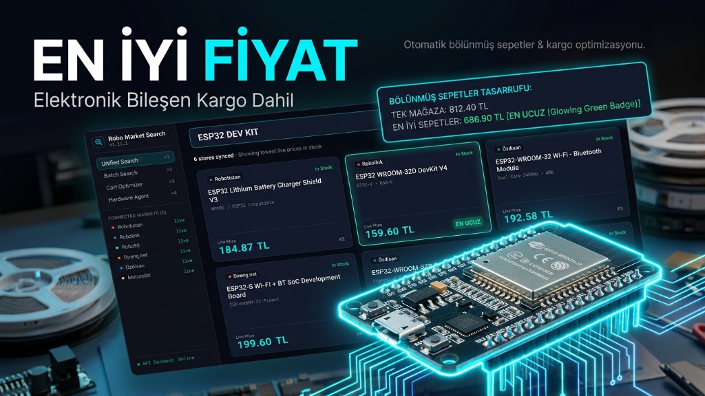
  </a>
</div>

Birden fazla malzeme satın almak istediğinizde, parçaları tek bir mağazadan mı yoksa kargo limitlerini (ücretsiz kargo eşiklerini) dikkate alarak farklı mağazalar arasında bölüşerek mi almanızın daha ucuza geleceğini otomatik hesaplayabilirsiniz:

```python
from robo_market_search import UnifiedSearchClient

client = UnifiedSearchClient()

# Birden fazla ürün için en optimal sepet kombinasyonunu bul
result = client.cart_search(queries=["ESP32", "L298N", "HC-SR04"])

# 1. Tüm mağazaların sepete özel toplamı ve kargo ücretleri
for summary in result.store_summaries:
    print(
        f"[{summary.store}] Ürün: {summary.total_price} TL | Kargo: {summary.shipping_cost} TL | Toplam: {summary.total_with_shipping} TL"
    )

# 2. Mağazalar arası en ucuz bölünmüş sepet kombinasyonu (Optimal Split)
if result.best_split:
    print(f"🏆 En Optimal Genel Toplam: {result.best_split.grand_total} TL")
```

*(Detaylı çalışan örnek için [`examples/cart_search_example.py`](examples/cart_search_example.py) dosyasına göz atabilirsiniz.)*

## Sıkça Sorulan Sorular (S.S.S. / FAQ)

<details>
<summary><b>Hangi sitenin SEO'su daha iyi ise ona arama sonuçlarında öncelik veriliyor mu?</b></summary>
<br/>

**Hayır, kesinlikle hayır.**

Robo Market Search bir Google veya Yandex gibi web arama motoru değildir; sitelerin SEO puanları, Backlink'leri veya Google sıralamaları sonuçlarımızı **hiçbir şekilde etkilemez.**

Sistem tamamen tarafsız bir kazıma (scraping) ve fiyat karşılaştırma mantığıyla çalışır:
1. Bir kelime aratıldığında 6 marketin (Robotistan, Robolink, Robo90, Direnç.net, Özdisan, Motorobit) kendi iç arama motorlarına **eşzamanlı (paralel)** doğrudan istek atılır.
2. Gelen tüm ürünler eşit şartlarda toplanır ve standart `Product` modeline dönüştürülür.
3. Varsayılan olarak sonuçlar **sadece ve sadece ürün fiyatına göre (en ucuzdan en pahalıya)** sıralanır.

Dolayısıyla hiçbir markete SEO veya popülerlik avantajı tanınmaz; kullanıcıya her zaman en net ve en ucuz fiyat alternatifi sunulur.
</details>

<details>
<summary><b>Ürünlerin fiyat ve stok bilgileri ne kadar güncel?</b></summary>
<br/>

Arama yapıldığı an 6 marketin canlı arama API ve web sayfalarına anlık HTTP istekleri atılır. Dolayısıyla görüntülenen fiyat ve stok durumu **%100 canlı ve anlıktır.** Ayrıca önbellek (cache) mekanizması isteğe bağlı çalışır ve varsayılan olarak 2 saatte bir güncellenir. Ozdisan ve Motorobit sonuçları 1 saat sonra yenilenir. `ROBO_REDIS_URL` tanımlıysa önbellek Redis'te tutulur (`pip install "robo-market-search[redis]"`).
</details>

<details>
<summary><b>Birden fazla farklı parça alırken kargo ücretlerini nasıl optimize ediyorsunuz?</b></summary>
<br/>

`cart_search` metodu veya masaüstü uygulamamızdaki sepet optimizasyonu özelliği sayesindedir. Sistem, listenizdeki parçaların hangi marketlerde olduğunu ve her marketin **ücretsiz kargo barajını (örn. 250 TL üzeri bedava kargo)** analiz eder. Ürünleri tek bir mağazadan toplu almak mı yoksa kargo limitlerini aşacak şekilde mağazalar arasında bölüşmek mi (split cart) daha ucuza gelir otomatik hesaplar.
</details>

<details>
<summary><b>Yeni bir elektronik mağazası eklemek istersem ne yapmalıyım?</b></summary>
<br/>

Projemiz modüler bir mimariye sahiptir! Yeni bir market eklemek için `src/robo_market_search/` altında `BaseStore` sınıfından türeyen ve `@register_store` ile işaretlenen yeni bir istemci oluşturmanız yeterlidir. Katkıda bulunmak için [docs/providers.md](docs/providers.md) ve [CONTRIBUTING.md](CONTRIBUTING.md) belgelerini inceleyebilirsiniz.
</details>

<details>
<summary><b>Claude, ChatGPT veya VS Code üzerinde MCP (Model Context Protocol) olarak nasıl kullanabilirim?</b></summary>
<br/>

`pip install "robo-market-search[all]"` kurulumundan sonra gelen `robo-mcp` komutunu Claude Desktop veya VS Code (Cline / RooCode) ayarlarınızdaki `mcpServers` bölümüne eklemeniz yeterlidir. Detaylı rehber yukarıdaki **Model Context Protocol (MCP) Sunucusu** başlığında adım adım açıklanmıştır.
</details>

## Katkıda Bulunma

Katkılarınızı memnuniyetle karşılıyoruz! Detaylı bilgi için [CONTRIBUTING.md](CONTRIBUTING.md) ve [docs/development.md](docs/development.md) sayfalarını inceleyebilirsiniz.

### Makefile ile Hızlı Geliştirici Komutları

Projede test, formatlama, tip kontrolü ve servis çalıştırma süreçlerini otomatikleştiren bir [`Makefile`](Makefile) bulunmaktadır:

| Komut | Açıklama |
| :--- | :--- |
| `make help` | Tüm mevcut hedefleri ve açıklamalarını listeler |
| `make setup` | Geliştirici paketlerini kurar ve pre-commit hook'larını aktif eder |
| `make test` | Pytest test paketini çalıştırır |
| `make test-cov` | Testleri kapsam (coverage) raporu ile yürütür |
| `make test-api` | Çalışan API'ye karşı [`bruno/`](bruno/) koleksiyonunu çalıştırır (`@usebruno/cli` gerekir) |
| `make check` | Format, lint (Ruff) ve tip (Mypy) kontrollerini çalıştırır |
| `make fix` | Kod formatlama ve lint hatalarını otomatik düzeltir |
| `make run-api` | FastAPI REST API sunucusunu ayağa kaldırır (port 8000) |
| `make run-agent` | Donanım ajanını (CLI) başlatır |
| `make app-up` | Uygulama ortamını (React + FastAPI) Docker ile başlatır |
| `make clean` | Geçici derleme ve önbellek dosyalarını temizler |

---

Projemizin gelişmesinde emeği geçen ve katkıda bulunan tüm topluluk üyelerine teşekkür ederiz!

- [**Sha-Dox**](https://github.com/Sha-Dox): Sepet optimizasyonu, kargo ücreti hesaplaması ve multi-store split algoritmalarının (`cart_search`) geliştirilmesine katkılarından dolayı özel teşekkürler!

## Güvenlik

Güvenlik açığı bildirimi için [SECURITY.md](SECURITY.md) dosyasındaki talimatları izleyin.

## Davranış Kuralları

Bu proje [Katılımcı Sözleşmesi](CODE_OF_CONDUCT.md) ile yönetilmektedir.

## Lisans
Apache License 2.0
