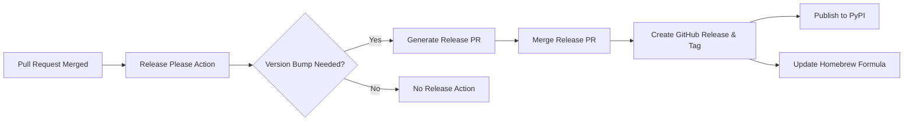

# Product Roadmap

This document defines the development milestones, architecture evolution, and release schedule for Robo Market Search.

The project follows [Semantic Versioning 2.0.0](https://semver.org/). Releases are automated through Conventional Commits and [Release Please](https://github.com/googleapis/release-please).

---

## Milestone Overview

| Milestone | Target Scope | Status | Focus Area |
| :--- | :--- | :--- | :--- |
| **v1.0.0 - v1.9.0** | Foundation & Ecosystem | Completed | Core scrapers, Unified Search, MCP server, Telegram bot, Vite Web UI. |
| **v1.10.0** | UI/UX & Packaging | Current Release | Rich CLI interface, Homebrew Tap integration, security hardening, Web standards. |
| **v1.11.0** | Pipeline & Automation | Ready for Release | Full Dependabot ecosystem coverage, automated pre-commit updates, dynamic CLI metadata. |
| **v1.12.0** | Scraper Expansion & Cache | In Development | Ozdisan scraper integration, Redis caching layer in `robo_market_service`. |
| **v1.13.0** | Real-Time Streaming | Planned | Server-Sent Events (SSE) and WebSocket streaming for agent reasoning traces. |
| **v2.0.0** | Graph & Multi-Currency | Future Architecture | Component pin-compatibility graph, multi-currency conversion, unified GraphQL API. |

---

## Detailed Milestones

### Completed Milestones

#### v1.0.0 - v1.9.0: Foundation & Multi-Interface Support
- Core HTTP client with `curl_cffi` browser fingerprint impersonation.
- Scraper engines for Robotistan, Robolink, Robo90, and Direncnet.
- Unified search orchestrator with parallel query execution and deduplication.
- Split-cart shopping cost optimizer with store-specific free shipping thresholds.
- Fast-path containerization with root and demo Dockerfiles.
- REST API layer built on FastAPI with BYOK (Bring Your Own API Key) authentication.
- Model Context Protocol (MCP) server for Claude Desktop and AI editor integration.
- Telegram bot interface for real-time component queries and cart calculation.
- Web demonstration application using React 18, Tailwind CSS v3, and Vite.

#### v1.10.0: Terminal Experience & Packaging Hardening
- Complete redesign of the terminal interface using Rich with rounded box layouts.
- Clickable terminal hyperlinks (OSC 8) for product titles and direct store links.
- Smart subcommand routing: queries such as `robo-search "ESP32"` execute without explicit `search` keyword.
- Best-price detection with visual in-stock badges.
- Official Homebrew Tap distribution via `atacanymc/tap/robo-market-search`.
- Frontend modern web guidance alignment: dark mode synchronization, standardized scrollbars, accessible color contrast.
- Pre-commit pipeline modernization with Python 3.11 target alignment.

---

### In Progress & Upcoming Milestones

#### v1.11.0: Automation & Dependency Governance
- Dynamic CLI package version resolution via `importlib.metadata`.
- Repository-wide Dependabot configuration covering root, `/demo`, `/demo/backend`, `/demo/frontend`, Dockerfiles, and GitHub Actions.
- Automated weekly pre-commit hook update workflow via GitHub Actions.
- Dependency synchronization across Python packages and frontend build manifests.

#### v1.12.0: Scraper Expansion & Distributed Caching
- **New Scraper Integrations**:
  - [x] Implement `OzdisanClient` for industrial electronic components and IC distribution.
  - [x] Implement `MotorobitClient` for robotics and automation hardware.
- **Distributed Cache Layer**:
  - Add optional Redis backend to `robo_market_service` alongside the in-memory cache.
  - Implement TTL-based cache invalidation per market source.
- **Scraper Resilience**:
  - Circuit-breaker pattern to gracefully isolate failing market endpoints.
  - Automated fallback headers and catalog pagination recovery.

#### v1.13.0: Streaming Agent & Telemetry
- **Agent Streaming Protocol**:
  - Server-Sent Events (SSE) endpoint in `robo_market_api` for step-by-step BOM generation.
  - Real-time token streaming from LLM providers (OpenAI, Anthropic, Gemini, Groq, Ollama).
- **Price Alerting**:
  - Webhook delivery mechanism for component price drops and restock alerts.
  - Configurable target price threshold alerts via CLI and REST API.

#### v2.0.0: Advanced Component Graph & Enterprise Features
- **Component Equivalence Graph**:
  - Pin-to-pin and functional replacement suggestion engine for out-of-stock items.
  - Datasheet parameter normalization (voltage, footprint, current rating).
- **Internationalization & Currency**:
  - Multi-currency normalization (USD, EUR, TRY) using central bank exchange feeds.
  - Multi-language catalog matching for international components.
- **Client SDK Generation**:
  - Automated TypeScript client generation from OpenAPI specifications.
  - Python SDK asynchronous client parity across all endpoints.

---

## Release Process

Releases follow an automated continuous delivery flow:

---

## Feedback & Feature Proposals

Feature proposals and roadmap suggestions should follow the structured issue templates:

1. Check existing initiatives in the [Issue Tracker](https://github.com/AtaCanYmc/robo-market-search/issues).
2. Open a feature request using the structured GitHub Issue template with clear technical motivation and verification steps.
3. For architectural modifications, submit an Architecture Decision Record (ADR) draft in [`docs/adr/`](docs/adr/).
