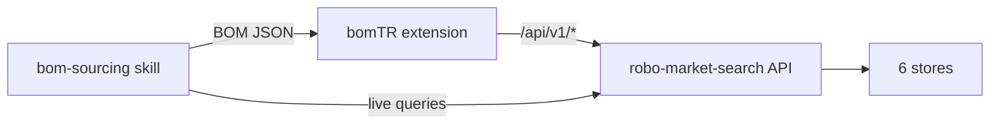

# Integrations

Two companion projects build on `robo-market-search`. Both are MIT licensed and maintained in separate repositories.

| Project | Type | Install | Source |
| :--- | :--- | :--- | :--- |
| `bom-sourcing` | Agent skill | `npx skills add AtaCanYmc/bom-sourcing` | [AtaCanYmc/bom-sourcing](https://github.com/AtaCanYmc/bom-sourcing) |
| `bomTR` | Chrome extension (Manifest V3) | [Chrome Web Store](https://chromewebstore.google.com/detail/bomtr/mllknkaempcjocdjibelcjohjadnffep) | [AtaCanYmc/bom-tr](https://github.com/AtaCanYmc/bom-tr) |

## bom-sourcing (agent skill)

Extracts a traceable Bill of Materials from hardware, IoT, maker, and software repositories, normalizes component names, and flags missing parts. Offline BOM generation makes no network calls. Live pricing, stock, cart, and shipping comparison go through `robo-market-search`.

```bash
# Current workspace
npx skills add AtaCanYmc/bom-sourcing

# All agents for the current user
npx skills add AtaCanYmc/bom-sourcing -g
```

Plugin manifests ship for Claude Code, Cursor, Antigravity, and Gemini CLI. See the [bom-sourcing README](https://github.com/AtaCanYmc/bom-sourcing#install-as-a-plugin).

## bomTR (Chrome extension)

Side-panel editor for `bom-sourcing` BOM files. It compares price and stock across the six supported stores. Without a running API it still supports local editing and opens `?q=...` search tabs on each store.

The extension talks to the REST API of this project (`GET/POST /api/v1/*`), by default at `http://127.0.0.1:8000`:

```bash
make run-api
```

Then install the extension and open the side panel with `Ctrl+Shift+B` (`Cmd+Shift+B` on macOS).

## Data flow


